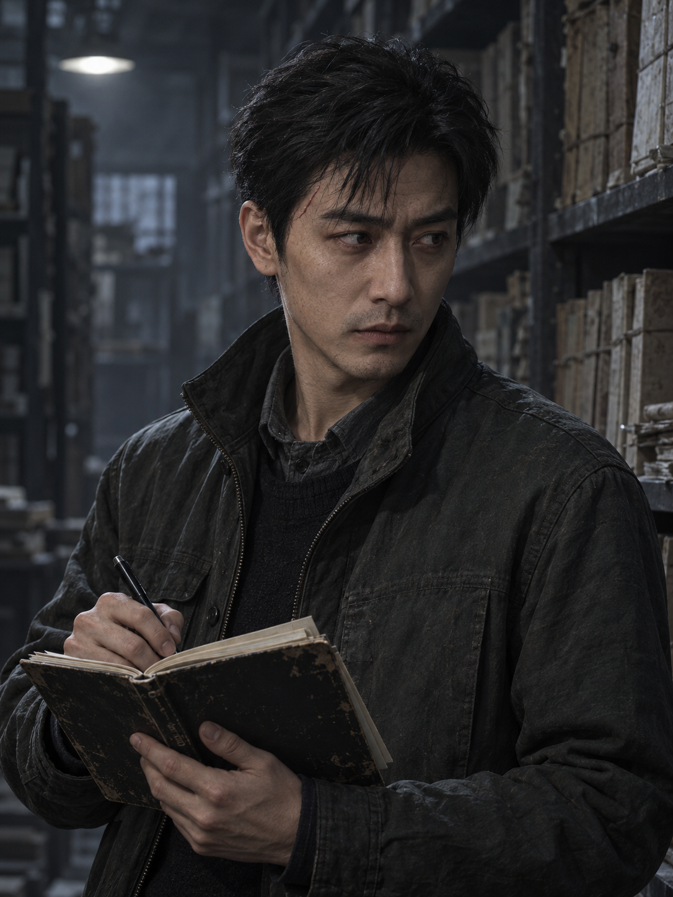
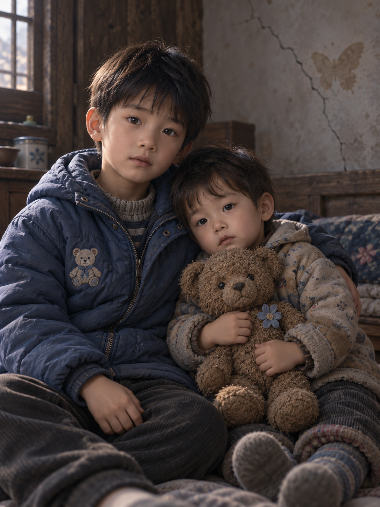
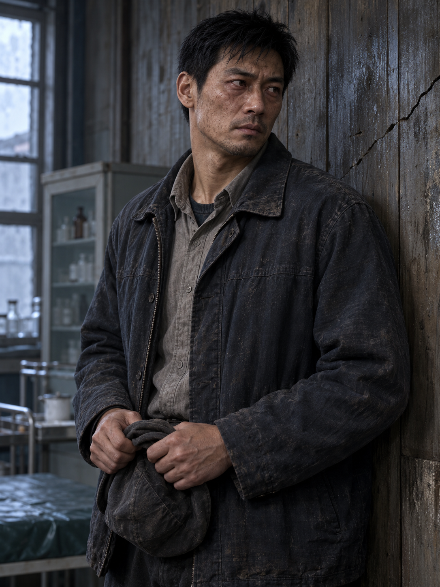

# 《双生血蛊案》AI 漫剧项目

本仓库整理原著、18 集漫剧分镜与画面提示词，以及角色和场景参考图。分镜方案按每集约 2 分钟规划；单个视频镜头会另行生成与剪辑。

## 内容

- [原著小说（DOCX）](./原著/双生血蛊案_原小说.docx)
- [18 集分镜与画面提示词（Markdown）](./剧本/双生血蛊案_AI漫剧_18集分镜与提示词.md)
- [18 集分镜与画面提示词（Word）](./剧本/双生血蛊案_AI漫剧_18集分镜与提示词.docx)
- [分镜草稿](./剧本/分镜草稿/)
- [人物参考图](./assets/人物参考图/)
- [场景背景图](./assets/场景背景图/)

## 人物参考

| 林珑 | 陈默 | 陈星与吴辰 |
|---|---|---|
|  |  |  |

| 吴刚 | 苏婉 | 陈建国 |
|---|---|---|
|  |  |  |

## 场景背景

背景图包括上海调查办公室、伦敦档案室、果敢老街诊所巷口、安康诊所主诊室与后屋、果敢医院病房、中国警方审讯室、陈建国旧居饭桌。

## 文件范围

本仓库不包含生成视频、音频、模型权重、ComfyUI 缓存或其他项目素材。

## 权利说明

本仓库未附开源许可。原著、改编剧本及图片的权利归各自权利人；公开可见不等于获得转载、改编或商业使用许可。
